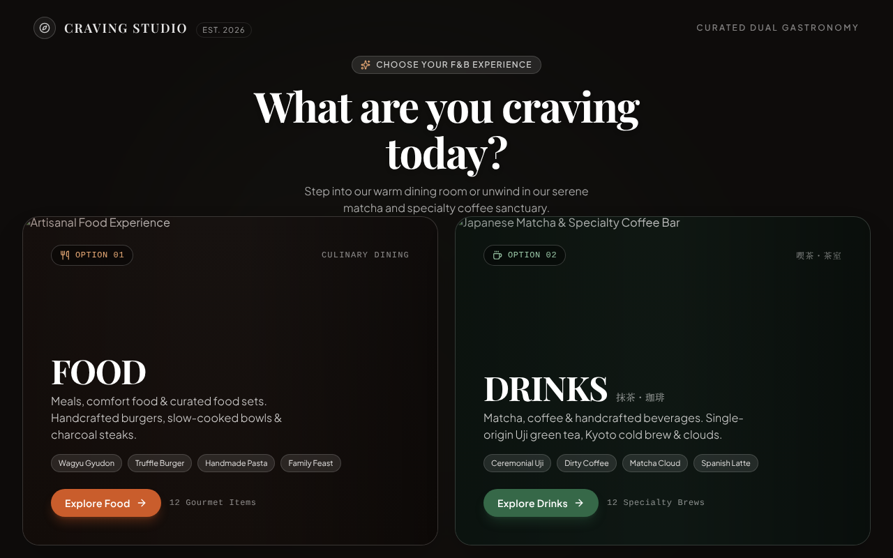
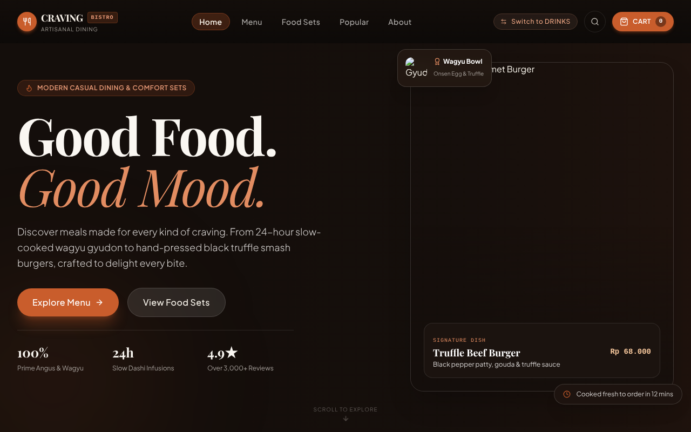
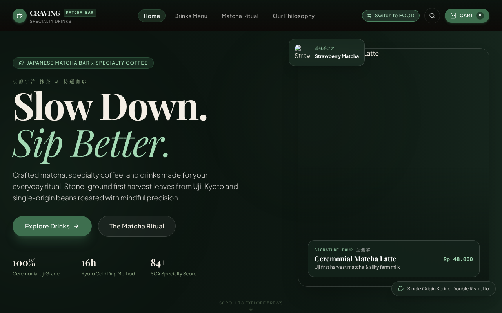
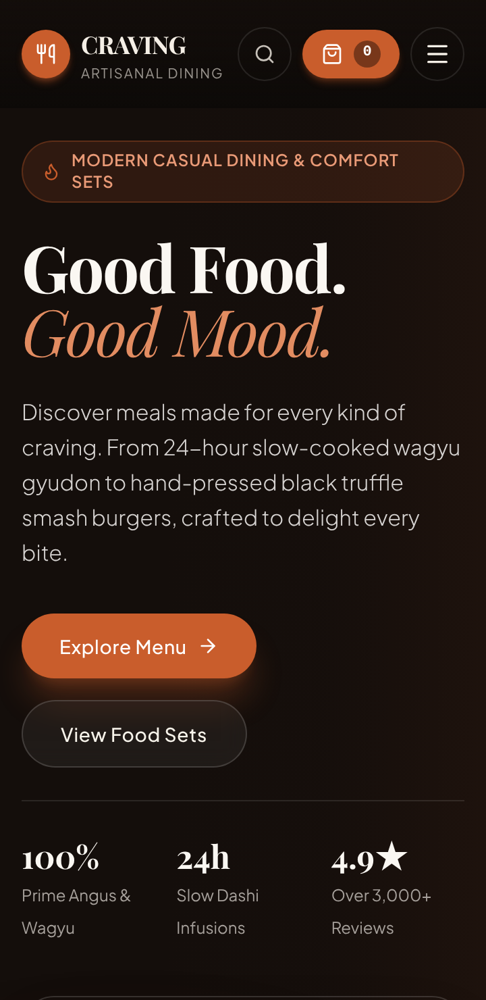

# Vassel F&B Experience

A luxury F&B web experience by Vassel Goleyu, featuring dual culinary worlds: artisanal modern casual dining and a Japanese matcha & specialty coffee bar. In the interface the brand appears as "Craving Studio".

The visitor first chooses a world on a landing screen, then browses that world's menu, customises items, fills a cart and goes through a simulated checkout.

| Landing | Food | Drinks |
| --- | --- | --- |
|  |  |  |

Mobile (360 px wide):



> The screenshots were captured from the running app in an environment that could not reach Unsplash or Google Fonts, so menu photos appear as empty frames and fonts fall back to system ones. In a normal browser the photos and fonts load.

## Features

* Landing screen with two worlds: **Food** (bistro) and **Drinks** (matcha bar).
* Menus with category filters, 12 food items and 12 drinks, plus curated food sets with a builder.
* Item customisation (size, spice, milk, sweetness, ice, add-ons and toppings) with live pricing.
* Cart drawer and floating cart bar, saved in `localStorage`, with a 5% service fee.
* Full-screen search across food, drinks and sets.
* Simulated checkout with a receipt.
* Keyboard accessible dialogs, visible focus, and `prefers-reduced-motion` support.

## Getting started

**Prerequisites:** Node.js 22 and npm.

```bash
npm ci          # install exactly what package-lock.json pins
npm run dev     # http://localhost:3000
```

## Scripts

| Script | What it does |
| --- | --- |
| `npm run dev` | Vite dev server on port 3000 |
| `npm run build` | Production build into `dist/` |
| `npm run preview` | Serve the production build locally |
| `npm run typecheck` | TypeScript check (`tsc --noEmit`); `npm run lint` is the same check |
| `npm test` | Unit tests (Vitest) |
| `npm run test:e2e` | End-to-end tests (Playwright, Chromium). Builds the app and serves it on port 4173 |
| `npm run clean` | Remove `dist/` |

The first time you run the e2e tests locally, install the browser with `npx playwright install chromium`.

## Project structure

```
index.html                  Page shell and metadata
src/
  App.tsx                   Switches between landing, food and drinks
  context/AppContext.tsx    App state: experience, cart, dialogs
  components/               Landing, navbar, cart, search, checkout
    FoodExperience/         Food world sections and modals
    DrinksExperience/       Drinks world sections and modals
  data/                     Menu, drinks and set content
  hooks/useDialog.ts        Escape, focus and Tab handling for dialogs
  lib/                      Pure helpers: cart maths, pricing, search, formatting, images
  types.ts                  Shared types
e2e/                        Playwright tests
docs/AUDIT.md               Written audit and status of findings
.github/workflows/ci.yml    CI
```

## Testing

* **Unit tests** cover the pure logic in `src/lib` and the integrity of the menu data. They pin the time zone and do not depend on locale.
* **End-to-end tests** cover page load, navigation between the two worlds, adding to the cart, closing dialogs with Escape, keyboard use, reduced motion, absence of console errors and absence of horizontal scrolling at 360 px. Photos and fonts from external hosts are stubbed, so the suite does not need the network.
* **CI** (GitHub Actions, Node 22) runs typecheck, unit tests, build and the e2e suite on every push and pull request.

## Limitations

* Checkout is a front-end simulation only. There is no backend, no payment, no authentication and no real order handling. Order ids are random.
* All content (menu, prices, ratings, copy) is static data in `src/data`.
* Photos are hot-linked from Unsplash, so the app needs internet access to show them and has no local fallback.
* The app is a client-rendered single page. The HTML shell contains no menu content for crawlers.
* The JavaScript bundle is a single chunk of about 500 kB.
* `canonical`, `og:url`, `og:image` and a favicon are not set yet (see `TODO(vassel)` in `index.html`).

See [docs/AUDIT.md](docs/AUDIT.md) for the full list of findings.

## Author

Vassel Goleyu.

<!-- TODO(vassel): add a LICENSE file and state the license here. -->
